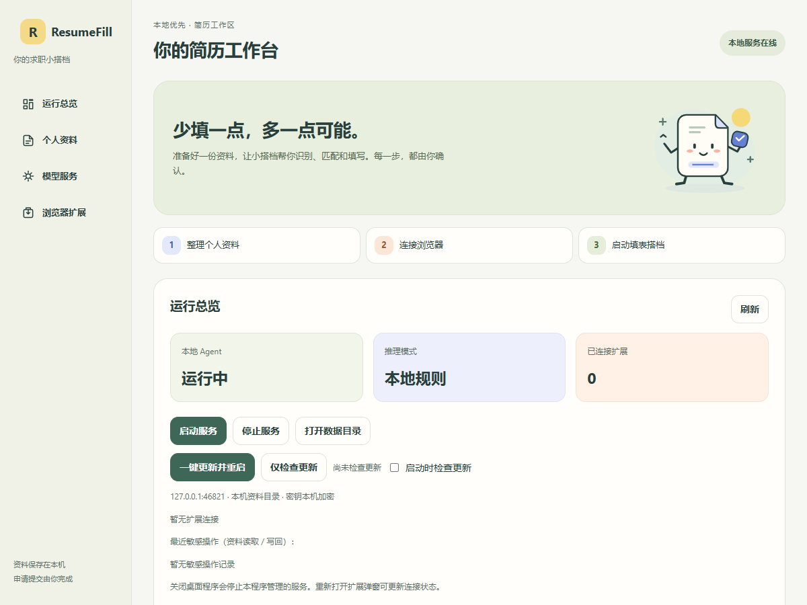
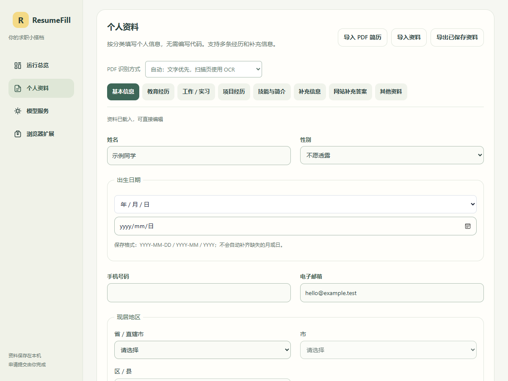

<p align="center"></p>

<h1 align="center">ResumeFill Agent</h1>
<p align="center">少填一点，多一点可能。<br>一份个人资料，复用到不同招聘表单。</p>
<p align="center"><a href="https://github.com/Simple-YU-268/ResumeFill/releases/latest">下载 Windows 版</a> · <a href="https://github.com/Simple-YU-268/ResumeFill/wiki">产品 Wiki</a> · <a href="docs/wiki/Getting-Started.md">安装指南</a> · <a href="https://github.com/Simple-YU-268/ResumeFill/issues">反馈问题</a></p>

**当前版本：0.22.0** · Windows 桌面端 + Chrome / Edge 扩展 · MIT 开源

ResumeFill 是本地优先的简历填表 Agent：把个人资料整理成可视化表单与 JSON，依据招聘网页实际显示的标签、位置和经历分组匹配字段，核对后填写并回读验证。遇到陌生字段，可由 AI 提供建议；你手动填写的内容也能经过确认后学习为新资料。最终申请由你提交。



## 三步开始

1. **准备资料。** 从 [Releases](https://github.com/Simple-YU-268/ResumeFill/releases/latest) 下载并安装 EXE。在“个人资料”用中文表单编辑，或导入 JSON / PDF 简历。
2. **连接浏览器。** 在桌面端打开插件目录，在 Chrome / Edge 扩展管理页启用开发者模式，加载该目录。插件点击“自动发现并连接桌面端”，首次在桌面端确认配对。
3. **扫描、核对、填写。** 切回招聘表单，从工具栏打开插件扫描，检查字段和经历归属，再点击填写。复杂控件或歧义项由你补充核对。

安装版包含运行环境、浏览器扩展和离线 OCR，无需 Node.js。扩展目前通过解压缩目录加载，**尚未上架商店**。详细步骤见 [安装与首次连接](docs/wiki/Getting-Started.md)。

## 能帮你做什么

| 能力 | 实际使用方式 |
| --- | --- |
| 可视化个人资料 | 编辑基本信息、多段教育 / 工作 / 项目经历、自定义字段和网站答案；JSON 可导入导出。 |
| 根据页面显示匹配 | 结合可见文字、布局、表格标签与经历容器；支持选定区块，避免同名字段串用。 |
| 下拉、地区与日期 | 固定选项同义词、省市区层级和日期精度；已适配的复杂控件核验真实选中项。 |
| 学习手动填写 | “重新扫描并学习已填内容”列出新增和修改项，勾选确认后保存到本地 JSON。 |
| 可选 AI 建议 | 本地结果先显示，再异步处理未解决字段；校验路径与经历归属，填写仍需你启动。 |
| PDF 与网页 OCR | PDF 文字提取、离线中英 OCR、可选 AI 解析；网页 OCR 补充图片标签。 |
| 桌面管理与更新 | 自动发现配对、授权撤销、服务状态和一键更新。 |



### 手动填过，下次少填

网页填完后，点击 **重新扫描并学习已填内容**。已有同义字段归入原资料，陌生字段保存为带网站、区块和经历序号的补充答案。修改项默认不选；敏感资料需单独确认。保存前再次检查网页值和本地资料，并保留一次学习前备份。

它只读取当前可见表单和可见同源 iframe，不读取其他分页、附件或未展开项。密码、验证码、安全答案、占位和已识别的脱敏内容不学习；学习不向 AI 发送读取的值。详见 [资料与表单学习](docs/wiki/Profile-and-Learning.md)。

## 隐私与实际边界

- 资料默认保存在本机；桌面端与扩展各有一份资料，已有内容不会在首次连接时被静默替换。
- AI 可选。主动匹配默认仅发送未解决字段标签及候选路径；PDF AI 解析需明确授权发送提取的原文。见 [隐私与安全](docs/wiki/Privacy-and-Security.md)。
- 本地网关监听回环地址；首次配对需桌面端确认。桌面凭据使用 Windows 系统加密，扩展令牌与云端密钥分开管理。
- 不保证所有招聘网站都能自动填写。跨域 iframe、未适配控件、归属歧义、日期精度不足等需人工处理。回读一致不等于服务器已保存。
- 不自动提交申请，不代填密码或验证码。Windows 安装程序目前未代码签名，请从本仓库发行页下载。

## 产品文档

文档同时维护在 [GitHub Wiki](https://github.com/Simple-YU-268/ResumeFill/wiki) 与仓库内，支持离线阅读和版本追踪。

| 文档 | 内容 |
| --- | --- |
| [安装与首次连接](docs/wiki/Getting-Started.md) | 下载、加载扩展、配对、升级 |
| [填写与匹配](docs/wiki/Autofill.md) | 扫描、多段经历、地区、日期、iframe |
| [资料与表单学习](docs/wiki/Profile-and-Learning.md) | 个人资料、PDF 导入、差异预览和保存 |
| [AI 与 OCR](docs/wiki/AI-and-OCR.md) | 模型配置、测试、请求范围、图片识别 |
| [隐私与安全](docs/wiki/Privacy-and-Security.md) | 存储、配对、外发数据和保护边界 |
| [常见问题](docs/wiki/Troubleshooting.md) | 401 / 404、连接、扫描与匹配歧义 |
| [开发与发行](docs/wiki/Development-and-Releases.md) | 测试、构建、版本和发行资产 |

## 本地开发

需要 Node.js 22.13+，建议 Node.js 24；浏览器测试默认使用已安装的 Edge。

```powershell
npm ci
npm --prefix desktop ci
npm --prefix desktop run prepare:resources
npm test
npm --prefix desktop start
```

| 命令 | 用途 |
| --- | --- |
| `npm run test:browser` | 独立浏览器中的控件、插件、Agent 和学习回归 |
| `npm run test:desktop` | 桌面控制器、配对、更新和同步 |
| `npm run test:electron` | Electron / PDF 集成；无法启动 GUI 时部分测试可能跳过 |
| `npm run version:check` | 检查版本一致 |
| `npm run privacy` | 扫描待公开源码 |
| `npm run build` | 构建 Windows 安装程序，输出到 `dist/` |

构建后另需针对实际输出目录检查隐私，见 [开发与发行](docs/wiki/Development-and-Releases.md)。测试使用合成资料与临时目录；不要提交真实简历、凭据、检查点或浏览器配置。

## 参与改进

在 [Issues](https://github.com/Simple-YU-268/ResumeFill/issues) 提供浏览器和版本、脱敏字段名称、控件类型、预期与实际行为。不要上传身份证号、密钥、完整简历或带会话参数的页面链接。

[更新记录](CHANGELOG.md) · [隐私审查](PRIVACY-REVIEW.md) · [公开插件研究](COMPETITOR-RESEARCH.md) · [第三方许可](THIRD_PARTY_NOTICES.md) · [MIT License](LICENSE)
